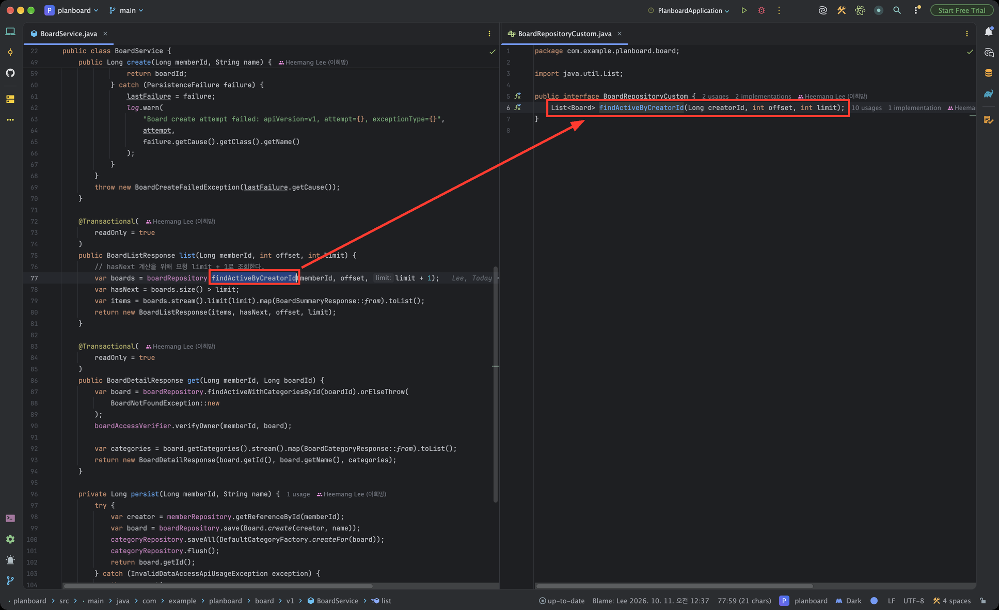

# intellij-plugins

개인적으로 사용하는 IntelliJ IDEA 플러그인 모음이다.

| 플러그인 | 설명 |
| --- | --- |
| [goto-right-split](#goto-right-split) | Cmd+Option+클릭한 코드의 선언을 우측 분할 창에서 연다. |

## goto-right-split

코드를 읽다가 선언을 확인할 때 원래 보던 코드를 잃지 않도록, 선언을 우측 분할 창에서 연다.
좌측 창은 원래 코드를 보는 용도, 우측 창은 선언의 상세 내용을 보는 용도로 쓴다.

### 스크린샷



### 동작

- 에디터에서 클래스·메서드·필드 이름을 **Cmd+Option+좌측 클릭**하면 선언이 우측 분할 창에 열린다.
- 우측 분할 창이 없으면 새로 만들고, 이미 있으면 그 창을 재사용한다. 클릭할 때마다 분할 창이 늘어나지 않는다.
- 우측 창 안에서 다시 Cmd+Option+클릭하면 우측 창 안에서 이동한다. 좌측 창의 코드는 그대로 유지된다.
- 라이브러리 클래스는 소스가 첨부되어 있으면 소스 파일로 이동한다.
- 에디터 우클릭 메뉴의 **Go To → Go to Declaration in Right Split**으로도 실행할 수 있다.

### 주의 사항

- macOS 기본 키맵에서 Cmd+Option+클릭은 원래 **Go to Implementation**에 할당되어 있다.
  이 플러그인이 우선 실행되도록 설정되어 있으므로, Go to Implementation은 키보드 단축키(Cmd+Option+B)로 사용한다.
- 우측 분할 창 처리는 IntelliJ의 "Open in Right Split" 내부 구현을 호출한다.
  공개 API가 아니므로 IntelliJ 메이저 버전이 바뀌면 다시 빌드하거나 코드를 수정해야 할 수 있다.

### 요구 사항

- IntelliJ IDEA 2026.1(빌드 261) 이상
- JDK 21

### 빌드·설치

`build.gradle.kts`는 `/Applications/IntelliJ IDEA.app`에 설치된 IDE를 컴파일 대상으로 사용한다.
다른 위치에 설치되어 있다면 `intellijPlatform { local(...) }`의 경로를 수정한다.

#### 직접 하는 방법

1. 플러그인을 빌드한다.

   ```bash
   cd goto-right-split
   ./gradlew buildPlugin
   ```

   `build/distributions/goto-right-split-<version>.zip`이 생성된다.

2. IntelliJ에서 **Settings → Plugins → ⚙ → Install Plugin from Disk...** 로 zip을 선택한다.
3. IDE를 재시작한다.
4. **Settings → Plugins → Installed**에 **Go to Declaration in Right Split**이 있는지 확인한다.

#### AI에게 시키는 방법

AI 코딩 에이전트를 이 저장소 루트에서 실행하고 아래 내용을 그대로 전달한다.

```text
goto-right-split 플러그인을 빌드하고 내 IntelliJ에 설치해줘.

1. /Applications/IntelliJ IDEA.app 이 있는지 확인해. 없으면 실제 설치 경로를 찾아서
   goto-right-split/build.gradle.kts 의 intellijPlatform { local(...) } 경로를 바꿔.
2. goto-right-split 디렉토리에서 ./gradlew buildPlugin 을 실행해.
3. ~/Library/Application Support/JetBrains/ 아래에서 실행 중인 IntelliJ 버전의
   설정 디렉토리(IntelliJIdea<버전>)를 찾아, 그 안의 plugins/ 에
   build/distributions/goto-right-split-<version>.zip 을 압축 해제해.
   기존 plugins/goto-right-split 이 있으면 지우고 새로 풀어.
4. 실행 중인 IntelliJ는 종료하지 말고, 재시작이 필요하다고만 알려줘.
```

AI가 설치를 마치면 IDE를 직접 재시작하고, 직접 하는 방법의 4번처럼 설치 여부를 확인한다.
